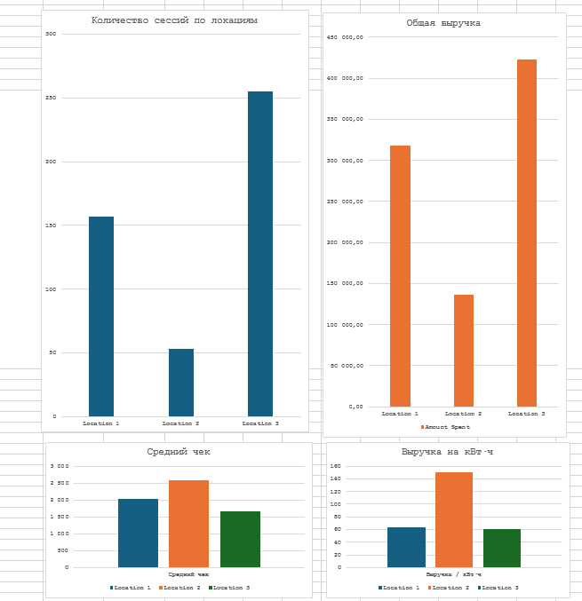
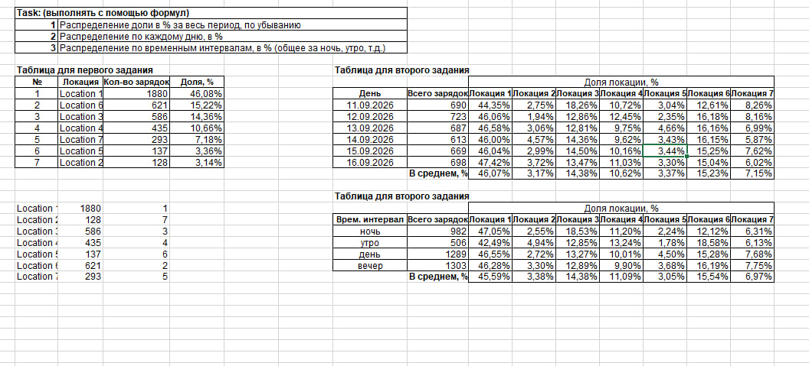

# Анализ эффективности сети зарядных станций (EV) в Excel

## 1. Описание задачи
Проведен операционный и продуктовый анализ выгрузки зарядных сессий сети электрозаправок. 
**Цель:** оценить эффективность локаций, выявить факторы роста выручки, проанализировать динамику нагрузки по времени суток и найти технические аномалии в логировании сессий.

## 2. Инструменты и навыки
* **Microsoft Excel:** сводные расчеты, очистка данных, визуализация.
* **Функции:** `INDEX / MATCH`, `SUMIFS`, `COUNTIFS`, `AVERAGEIF`, `VLOOKUP`, `RANK`, `TRIM`.

## 3. Ключевые метрики и сравнение локаций
Сравнение 3 основных точек (Location 1, 2, 3) показало три разные бизнес-модели:
* **Location 3 — лидер по трафику и выручке:** 255 сессий (выручка 423 345), но самый низкий средний чек (1 660). Выручка формируется за счет высокой проходимости.
* **Location 2 — премиальный сегмент:** всего 53 сессии, но самый высокий средний чек (2 575, на 55% выше Location 3) за счет повышенного тарифа (150 за кВт·ч против ~61–63 на других точках).
* **Location 1 — длинные сессии:** самая высокая средняя длительность зарядки (37,2 мин) и объем энергии на одну сессию (32,3 кВт·ч).

## 4. Выявленные аномалии в данных (Data Quality)
В ходе проверки выгрузки обнаружены баги телеметрии, требующие передачи в разработку:
1. **Нулевая длительность при ненулевой энергии:** например, в строке 142 указано 0 мин, хотя по меткам времени сессия длилась 49 секунд и было передано 0,43 кВт·ч.
2. **Рассинхрон дат и длительности:** зафиксированы записи, где длительность указана как 1–3 минуты, но разница между `Start Datetime` и `End Datetime` составляет 1–3 суток.
3. **Сбой логирования 7 сентября (Location 3):** из 39 сессий 18 записались с нулевой переданной энергией.
4. **Аномалия 4 сентября (Location 3):** резкий скачок числа сессий до 47 в день (против средних ~12) с изменением тарифа (54 вместо стандартных 63 за кВт·ч).

## 5. Динамика по времени суток и дням
* **Location 1** стабильно генерирует ~46% всего трафика сети (1 880 зарядок из 4 080).
* Пиковая нагрузка на сеть приходится на **вечер** (1 174 сессии) и **день** (1 163 сессии), минимальная — на **утро** (521 сессия).

## 6. Рекомендации для бизнеса
1. Проверить контроллеры и логирование на Location 3 (особенно за 4 и 7 сентября) для устранения потерь данных.
2. Настроить автоматическую валидацию поля `Duration (min)` при выгрузке из БД.
3. Протестировать динамическое ценообразование в вечерние пиковые часы на самых загруженных точках (Location 1 и Location 6).

---
📂 **[Скачать полный Excel-файл с формулами и расчетами](./evСhargingAnalysis.xlsx)**
